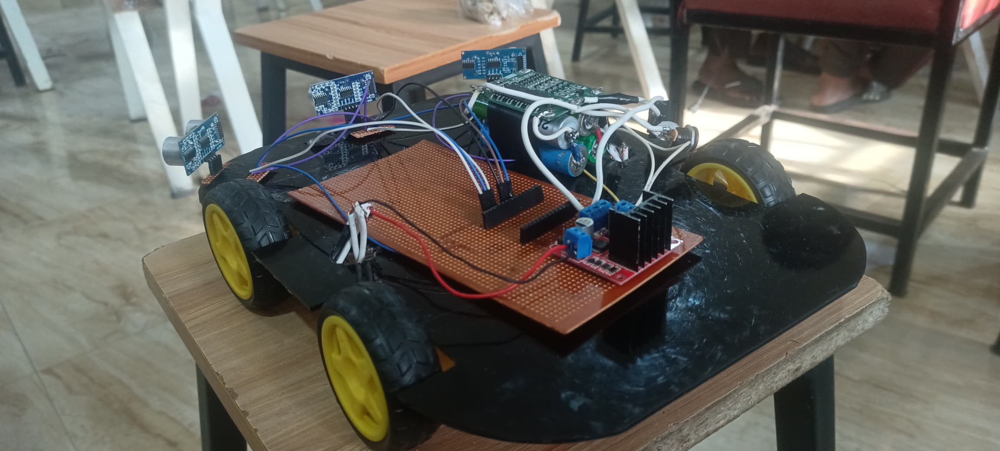
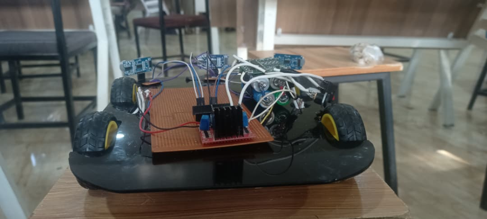
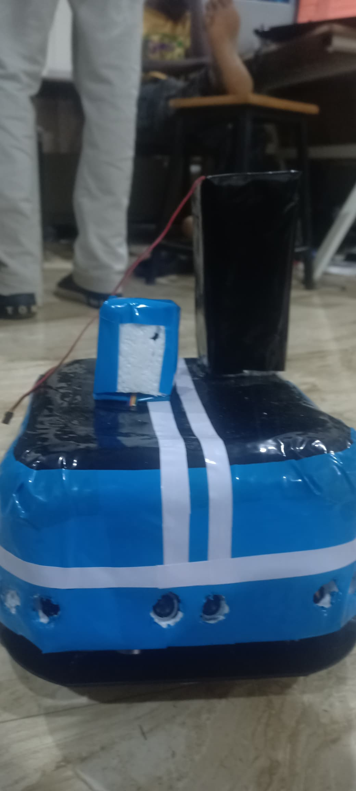

# Development of an Unmanned Ground Vehicle (UGV) for Autonomous Surveillance and Weapon Detection (AS-WD)

[]()
[-blue.svg)]()
[]()

## 📌 Project Overview
This repository contains the hardware firmware, computer vision models, and system integration code for the **Development of an Unmanned Ground Vehicle (UGV) for Autonomous Surveillance and Weapon Detection (AS-WD)**. Developed as an undergraduate final year thesis project at the Air Force Institute of Technology (AFIT), Kaduna, this system addresses perimeter security challenges by combining autonomous mobile robotics with real-time edge AI and IoT telemetry.

📄 **Full Technical Documentation:** Read the complete [Technical Project Report](docs/project_report.md) for detailed circuit diagrams, power budgets, training configurations, and experimental evaluation results.

---

## 🤖 Physical Prototype & Hardware Build

| Open Chassis & Electronics Assembly | Rear / Veroboard & Power Layout | Enclosed UGV Body Shell |
| :---: | :---: | :---: |
|  |  |  |

Additional build and assembly views (front profile, side elevation, and top enclosure angle) are available in [`media/hardware/`](media/hardware/) and CAD dimension drawings are stored in [`hardware/cad_drawings/`](hardware/cad_drawings/).

---

## 🚀 Key Technical Features & Capabilities

* **Real-Time Edge AI Detection:** Integrates a custom-trained **YOLOv11** deep learning model (`mAP@0.5: 0.8717`, `84.7%` True Positive Rate) for real-time object recognition and automated firearm detection via an ESP32-CAM module.
* **Autonomous Navigation & Sensor Fusion:** Implements multi-sensor fusion combining an **MPU6050 6-axis IMU** and **HC-SR04 ultrasonic sensors** to achieve stable trajectory tracking, path planning, and dynamic obstacle avoidance (`94.2%` static obstacle avoidance success rate).
* **IoT & Wireless Telemetry:** Integrates a **NEO-6M GPS** module and **SIM800L GSM** module via UART to dispatch automated SMS emergency alerts with real-time geographic coordinates within an average end-to-end latency of `4.9 seconds`.
* **Embedded Power & Control Architecture:** Powered by a **4S 14.8V Li-ion battery pack** with a **40A BMS** (`~6.2 hours` mixed operational runtime), driving a 4-wheeled differential-drive chassis through an **L298N H-Bridge motor driver** coordinated by an **ESP32-WROOM-32** microcontroller.

---

## 🛠️ Tech Stack & Tools

* **Programming Languages:** Python, C, C++
* **Computer Vision & AI:** PyTorch, Ultralytics YOLOv11, OpenCV, Google Colab (Tesla T4 GPU)
* **Embedded Systems & Protocols:** ESP32-WROOM-32, ESP32-CAM, Arduino IDE, UART, I²C, NMEA (`TinyGPS++`), AT Commands
* **Hardware & Mechanical Design:** SolidWorks CAD modeling, Acrylic chassis fabrication, L298N Motor Driver, HC-SR04 Ultrasonic Sensors, MPU6050 IMU, NEO-6M GPS, SIM800L GSM, 4S 40A BMS, LM2596 Buck Converter
* **Version Control:** Git & GitHub

---

## 📂 Repository Structure

```text
Development-of-an-Unmanned-Ground-Vehicle-for-Autonomous-Surveillance-and-Weapon-Detection/
│
├── README.md                  # Project documentation and executive overview
├── LICENSE                    # MIT License with author and supervisor credits
│
├── firmware/                  # Microcontroller source code (ESP32 / Arduino)
│   ├── ugv_main_controller/   # Main Arduino sketch containing setup() and loop()
│   ├── motor_control/         # L298N motor driver (.h and .cpp)
│   └── sensor_integration/    # Ultrasonic, IMU, and GPS/GSM telemetry modules (.h and .cpp)
│
├── computer_vision/           # AI model deployment and vision scripts
│   ├── inference/             # Real-time YOLOv11 detection scripts (Python/OpenCV)
│   ├── training/              # Training reference & Colab screenshots
│   └── weights/               # Trained YOLOv11 model weights
│
├── hardware/                  # Circuit schematics and mechanical layouts
│   ├── cad_drawings/          # SolidWorks 2D/3D chassis drawings
│   └── schematics/            # Circuit wiring diagrams
│
├── media/                     # Visual demonstrations & hardware photos
│   ├── hardware/              # Physical chassis, electronics, and enclosure photos
│   ├── inference_gun_050.jpg  # YOLOv11 weapon detection screenshot (0.50 confidence)
│   ├── inference_gun_047.jpg  # YOLOv11 weapon detection screenshot (0.47 confidence)
│   └── demo_video.mp4         # Field test and navigation demonstration
│
└── docs/                      # Thesis reports and technical documentation
    └── project_report.md      # Complete technical project report and test results
